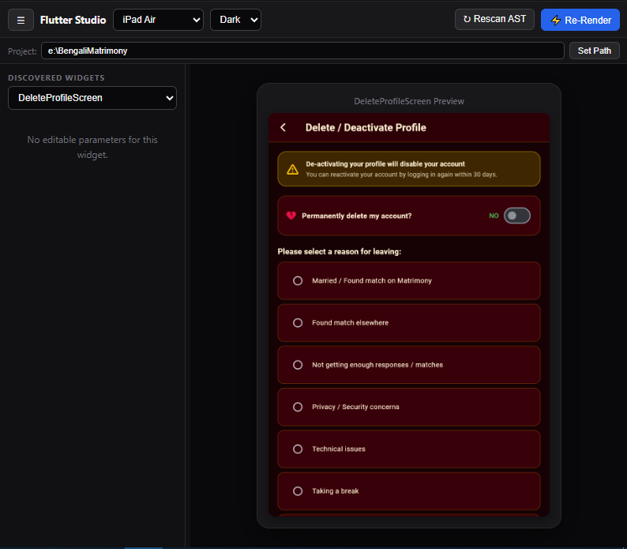

# Flutter Widget Studio (Flutter Widget Preview)

> An interactive visual Storybook & real-time preview sidecar for **Google Antigravity**. Preview and test isolated Flutter widgets, dialogs, and full screens instantly without launching an emulator or mobile device build.

---

<p align="center">
  
</p>

---

## 🌟 What is Flutter Widget Studio?

When building Flutter apps, running a full mobile emulator or waiting for full app rebuilds just to adjust UI components, padding, colors, or themes can slow down your design workflow.

**Flutter Widget Studio** opens an interactive visual canvas directly inside the Antigravity sidecar pane. It automatically analyzes your Flutter codebase, extracts every widget and screen, provides live controls to edit parameters on the fly, and displays a pixel-perfect preview in seconds.

---

## 🧭 Interface & Control Guide

Here is a breakdown of every button, menu, and control available in Flutter Widget Studio:

### 1. Top Navigation Toolbar

| Control | Description |
| :--- | :--- |
| **☰ (Hamburger Menu)** | Collapses or expands the left parameter sidebar so you can focus entirely on the full-screen preview canvas. |
| **Viewport Selector** | Switch between device form-factors on the fly (e.g. *iPhone 16 Pro*, *iPad Air*, *Pixel 8*, *Desktop / Web*). The canvas instantly resizes to the exact dimensions of that device. |
| **Theme Toggle** | Switch between **Light** and **Dark** mode to verify contrast, card styling, and theme colors without touching code. |
| **↻ Rescan AST** | Click this after adding new widgets, editing constructors, or changing files. The studio rescans your project and refreshes the widget list and parameter inputs. |
| **⚡ Re-Render** | Force a fresh render of the active widget canvas with all your current sidebar values. |

---

### 2. Project Path Bar

```text
Project: E:\YourFlutterApp                                      [ Set Path ]
```
- **Project Path Input**: Easily switch between multiple Flutter repositories or monorepo packages. Simply type or paste your project folder path and click **Set Path**.
- The studio automatically detects your widgets, models, enums, assets, and Google Fonts.

---

### 3. Left Control Sidebar & Parameters

- **Draggable Border**: Drag the vertical divider between the sidebar and canvas to customize your sidebar width.
- **Discovered Widgets Dropdown**: Search or select any widget or screen discovered in your project (e.g., `DeleteProfileScreen`, `PostCard`, `LoginScreen`, `CustomButton`).
- **Live Parameter Controls**: When a widget has configurable properties, the studio dynamically renders dedicated controls:
  - **Text Fields**: Edit string values like usernames, titles, or body copy.
  - **Toggles / Switches**: Flip booleans (`isLoading`, `isLiked`, `hasNotification`).
  - **Color Pickers**: Select custom colors directly.
  - **Dropdowns**: Choose enum values (`BadgeType`, `UserRole`, `Alignment`).
  - **Smart Mock Seeding**: Nullable or required values are seeded automatically with realistic mock data (e.g., sample user names, realistic dates, avatar URLs).

---

### 4. Live Preview Canvas

- **Device Frame**: Shows your widget rendered exactly as it will appear on real mobile and tablet devices.
- **Shimmer Loading State**: While rendering, an elegant shimmer effect indicates that your preview is updating.
- **Real Text & Icons**: Automatically renders crisp fonts (Google Fonts, custom fonts) and Material/Cupertino icons with zero missing glyph blocks.
- **Network & Asset Safety**: Network image calls and local assets are handled safely so your isolated components never throw network timeouts or crash on missing data.

---

## 🚀 How to Use

1. Open **Flutter Widget Preview** in your Antigravity sidecar pane.
2. Enter your Flutter project path in the top bar and click **Set Path**.
3. Select any widget from the **Discovered Widgets** dropdown.
4. Tweak properties in the sidebar or toggle Light/Dark themes and Viewports.
5. Watch your UI update live on the canvas!

---

## 📄 License
Licensed under the [Apache License, Version 2.0](LICENSE).
